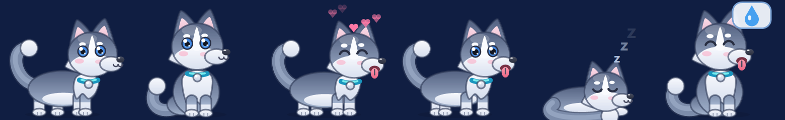

# Lucky 🐶: Husky desktop pet for Windows

A tiny Husky that lives on top of your Windows taskbar. It walks, sits, naps, chases your cursor and reminds you to drink water. It is written in a single C# file with no dependencies and uses about 20 MB of RAM.



## Features

- **Lives on the taskbar.** Lucky walks along the edge, sits, and curls up to sleep (with floating *z*'s).
- **Tail wag, tongue out, blinking.** Lucky wags harder when happy.
- **Chases your cursor** when you move the mouse near the taskbar.
- **Click to pet.** Lucky hops, smiles and shows hearts 💕
- **Drag & drop.** Drop Lucky anywhere and it falls back down with a little bounce.
- **Health reminder.** Every 45 minutes Lucky shows a water-drop bubble and a notification: drink water and stretch.
- **Hides automatically** while a full-screen app or game is in the foreground.
- **Tray menu.** Pet, sleep, wake, toggle the reminder, toggle *start with Windows*, quit.
- DPI aware with per-pixel alpha (layered window). Transparent pixels pass clicks through.

## Memory 🧠

Lucky saves what it remembers to `%APPDATA%\LuckyPet\memory.txt`. This is a plain `key=value` text file. Lucky writes it at most every 30 s when something changes, every 5 min regardless, on exit, and when Windows shuts down. Each write goes to a temp file first and then replaces the old one.

| Remembers | Effect |
|---|---|
| `first_met` | Days together. Lucky celebrates at 3 / 7 / 30 / 100 / 365 days |
| `last_seen` | After 12 h or more away, Lucky says it missed you, and affection drops a little |
| `affection` (0–100) | +3 per pet, +0.5 per chase, −1.2 per hour. A high value means more cursor chasing and more hearts. A low value means Lucky naps more |
| `pets`, `chases`, `naps`, `drops`, `reminders` | Shown in the **Kỷ niệm với Lucky 📖** tray menu. Lucky thanks you at 10 / 50 / 100 / 500 / 1000 pets |
| `pos_x`, `facing`, `remind_on` | Lucky comes back to the same spot with the same settings |

The tray tooltip shows the current affection and the number of days together.

## Snapshot

`Lucky.exe --snapshot out.png` renders every pose to a PNG without touching memory or the tray. `docs/poses.png` was made this way.

## Build & run

Requirements: Windows 10/11. It uses the C# compiler that ships with .NET Framework 4.x, so no SDK or Visual Studio is needed.

```powershell
./build.ps1
./bin/Lucky.exe
```

To start it with Windows, use the tray menu: **Khởi động cùng Windows**. This adds an `HKCU\...\Run` entry named `LuckyPet`.

## Design notes

- Rendering: GDI+ draws into a 32-bit ARGB bitmap, which is pushed with `UpdateLayeredWindow`. Frame rate is about 30 fps while moving and 20 fps while sitting or sleeping.
- Palette: grey-blue fur, white mask and paws, blue eyes, aquamarine collar with a silver tag.
- Everything is drawn procedurally. There are no image assets.
