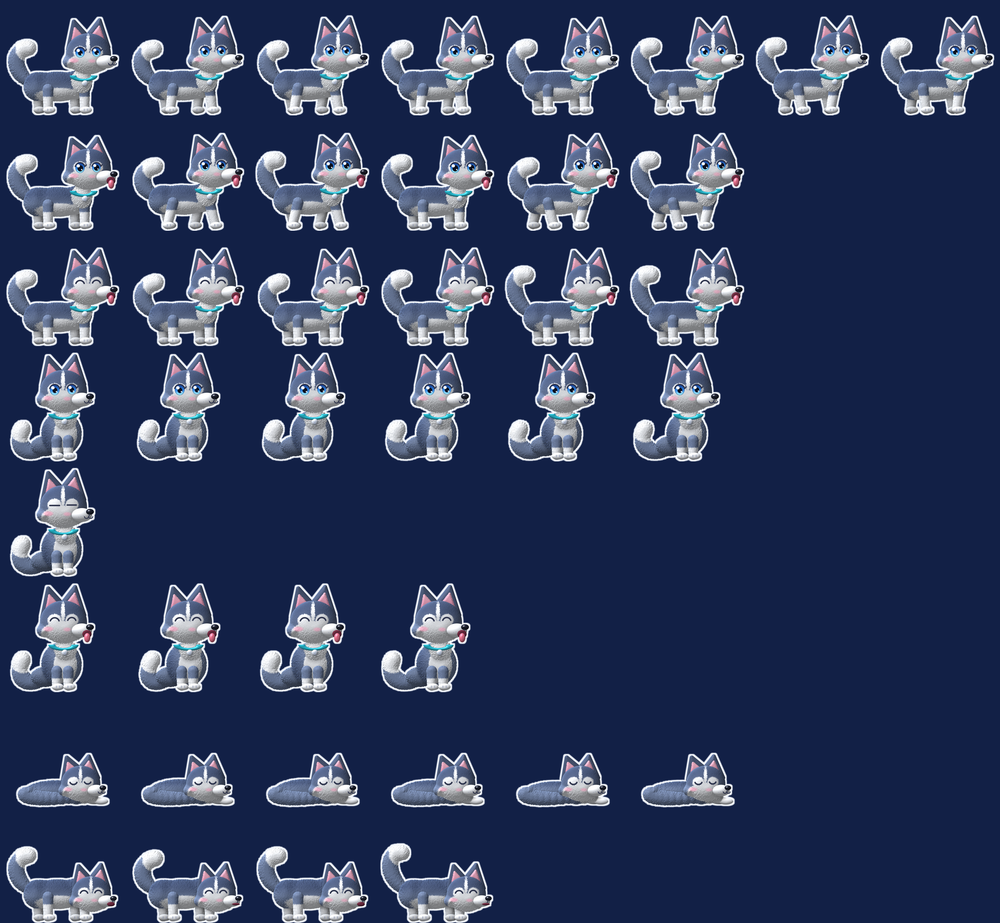

# Lucky 🐶: Husky desktop pet for Windows

A plush-looking Husky that lives on top of your Windows taskbar. Lucky walks, naps, fetches a ball, eats treats, cheers you on, keeps you company while you focus, and remembers you between sessions. The app is a single ~0.9 MB exe that uses about 40 MB of RAM and almost no CPU.



## Features

| | |
|---|---|
| 🚶 **Lives on the taskbar** | Walks, sits, blinks, wags, and curls up to sleep (floating *z*'s) |
| 🖱️ **Chases the cursor** | Chases your cursor near the taskbar. It does this more often the closer you are |
| 💕 **Click to pet** | Lucky hops, smiles, sticks out its tongue and shows hearts. Sometimes it says something cute |
| ✋ **Drag & drop** | Drop Lucky anywhere and it falls back down with a bounce |
| 🎾 **Fetch** | Double-click Lucky or use the menu to throw a ball. The ball bounces and rolls on the taskbar, Lucky runs after it and carries it back to your cursor. Click the ball to kick it again |
| 🦴 **Treats** | A bone drops and Lucky runs over and munches it. Lucky gets hungry after 6 h and will ask for one |
| 💬 **Speech bubbles** | Lucky says something encouraging every 20–35 min ("Bạn đang làm rất tốt luôn!") |
| 🎯 **Focus mode** | 25-minute Pomodoro. Lucky lies still and quiet, the tray shows a countdown, and it tells you to take a break at the end |
| 🌙 **Knows the time** | Lucky says good morning once a day and nudges you to go to bed after 23:00 |
| 💧 **Health reminder** | Every 45 minutes Lucky reminds you to drink water and stretch |
| 🎮 **Stays out of the way** | Hides while a full-screen app or game is in the foreground |
| 📏 **Three sizes** | Nhỏ / Vừa / Lớn |

## Memory 🧠

Lucky saves what it remembers to `%APPDATA%\LuckyPet\memory.txt`, a plain `key=value` file. Lucky writes it at most every 30 s when something changes, every 5 min regardless, on exit, and when Windows shuts down. Each write goes to a temp file first and then replaces the old one.

| Remembers | Effect |
|---|---|
| `first_met` | Days together. Lucky celebrates at 3 / 7 / 30 / 100 / 365 days |
| `last_seen` | After 12 h or more away, Lucky says it missed you, and affection drops a little |
| `affection` (0–100) | +3 per pet, +2 per fetch, +5 per treat, −1.2 per hour. A high value means more chasing and more hearts. A low value means Lucky naps more |
| `last_fed` | Lucky is hungry after 6 h and asks for a bone |
| `pets`, `balls`, `treats`, `chases`, `naps`, `drops`, `reminders`, `focus_sessions` | Shown in **Kỷ niệm với Lucky 📖** |
| `pos_x`, `facing`, `size`, `remind_on`, `last_morning`, `last_night` | Position, settings and daily greetings |

## Art

All sprites are drawn procedurally by [`art/render_sprites.py`](art/render_sprites.py) (Python, NumPy and Pillow):

- **Signed distance fields** with smooth unions, so the body parts blend like a plush toy.
- **Lighting from surface normals**: diffuse, specular and a cool rim light. Eyes and nose get extra gloss.
- **Fur grain and fluffy edges** from value noise anchored to each body part, so the texture doesn't swim between frames.
- **Ambient occlusion** where parts overlap, husky cap and goggle markings, anime eyes with a lash line and highlights.
- Rendered at 4×, downsampled in premultiplied space, with a **baked white sticker outline**.

```powershell
python art/render_sprites.py assets --preview docs/sprites.png   # regenerate sprites (~4 min)
```

## Build & run

Requirements: Windows 10/11. It uses the C# compiler that ships with .NET Framework 4.x, so no SDK is needed. `assets/*.png` are embedded into the exe.

```powershell
./build.ps1
./bin/Lucky.exe
```

To start it with Windows, use the tray menu: **Khởi động cùng Windows**. This adds an `HKCU\...\Run` entry named `LuckyPet`.
